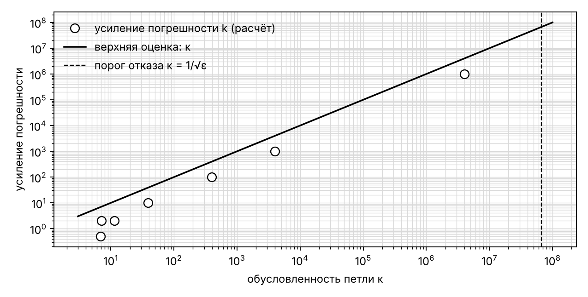
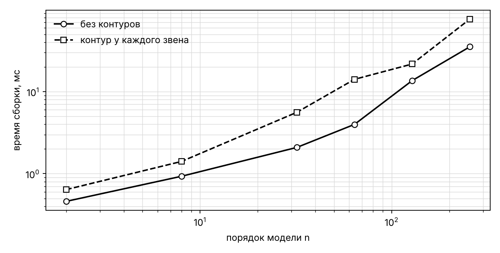

# Построение модели САУ в пространстве состояний по структурной схеме

_Сгенерировано `backend/scripts/kp_assembly_study.py` · Python 3.13.16 · Linux-6.18.44-fc-v153-x86_64-with-glibc2.39._

## 0. Примеры построения модели

| пример | ручной расчёт | состояния | A | B | C | D | det(sI − A) | расхождение с ручным |
|---|---|---|---|---|---|---|---|---|
| последовательное соединение | W = 2/(0,5s+1) · 1/s = 4/(s(s+2)) | lag, int | [-2 0; 1 0] | [4; 0] | [0 1] | [0] | 1 2 0 | 1.1e-16 |
| параллельное соединение | W = 1/(s+1) + 2 = (2s+3)/(s+1) | lag | [-1] | [1] | [1] | [2] | 1 1 | 1.8e-16 |
| обратная связь | W = 3/(s−1) / (1 + 3/(s−1)) = 3/(s+2) | plant | [-2] | [3] | [1] | [0] | 1 2 | 1.1e-16 |
| обратная связь через подсистему | та же схема, звенья внутри подсистемы: W = 3/(s+2) | object::plant | [-2] | [3] | [1] | [0] | 1 2 | 1.1e-16 |
| контур 3-го порядка | W = 2/(s³+3s²+2s) / (1 + 2/(s³+3s²+2s)) = 2/(s³+3s²+2s+2) | plant.x1, plant.x2, plant.x3 | [-3 -2 -2; 1 0 0; 0 1 0] | [2; 0; 0] | [0 0 1] | [0] | 1 3 2 2 | 8.5e-17 |
| контур без инерции, k = 0.5 | y = k/(1 − k)·u | — | [] | [] | [] | D = [1], κ = 7.12 | — | — |
| контур без инерции, k = 1 | y = k/(1 − k)·u | — | [] | [] | [] | Алгебраическая петля не имеет решения (матрица I − D·M вырождена): e → k. Измените коэффициенты петли или добавьте динамическое звено. | — | — |

## 1. Корректность на эталонных схемах

| схема | порядок n | входы × выходы | алг. контуры | ошибка метода | поблочный подход |
|---|---|---|---|---|---|
| series | 2 | 1 × 1 | 0 | 1.8e-16 | 1.8e-16 |
| parallel | 2 | 1 × 1 | 0 | 1.6e-16 | 1.6e-16 |
| branching | 1 | 1 × 2 | 0 | 0.0e+00 | 0.0e+00 |
| negative_feedback | 2 | 1 × 1 | 0 | 4.7e-16 | 4.7e-16 |
| positive_feedback | 1 | 1 × 1 | 0 | 0.0e+00 | 0.0e+00 |
| pid_loop | 3 | 1 × 1 | 0 | 6.1e-16 | 6.1e-16 |
| biproper_loop | 1 | 1 × 1 | 1 | 1.1e-16 | не собирает |
| static_loop | 0 | 1 × 1 | 1 | 0.0e+00 | не собирает |
| subsystem_feedback | 1 | 1 × 1 | 0 | 1.1e-16 | 1.1e-16 |
| flat_subsystem_feedback | 1 | 1 × 1 | 0 | 1.1e-16 | 1.1e-16 |
| two_instances | 2 | 1 × 1 | 0 | 5.6e-17 | 5.6e-17 |
| two_instances_with_inner_scopes | 2 | 1 × 3 | 0 | 5.6e-17 | 5.6e-17 |
| pass_through | 1 | 1 × 1 | 0 | 0.0e+00 | 0.0e+00 |
| nested_feedback | 1 | 1 × 1 | 0 | 1.1e-16 | 1.1e-16 |
| mimo_subsystem | 1 | 2 × 2 | 0 | 0.0e+00 | 0.0e+00 |
| butterworth | 4 | 1 × 1 | 0 | 8.9e-16 | 8.9e-16 |

## 2. Алгебраические контуры: y = k·(u + y)

Порог отказа: κ > 6.71e+07.

| k | κ скалярной петли | κ (программа) | y программы | y точное | отн. ошибка | усиление погрешности k | итог |
|---|---|---|---|---|---|---|---|
| 0.5 | 3 | 7.12 | 1 | 1 | 0.0e+00 | 2 | решён |
| 0.9 | 19 | 39 | 9 | 9 | 0.0e+00 | 10 | решён |
| 0.99 | 199 | 399 | 99 | 99 | 0.0e+00 | 100 | решён |
| 0.999 | 2e+03 | 4e+03 | 999 | 999 | 0.0e+00 | 1e+03 | решён |
| 0.999999 | 2e+06 | 4e+06 | 999999 | 999999 | 0.0e+00 | 1e+06 | решён |
| 0.999999999999 | 2e+12 | — | — | 1e+12 | — | — | отказ: плохо обусловлен |
| 1 | inf | — | — | inf | — | — | отказ: вырожден |
| 1.5 | 5 | 11.4 | -3 | -3 | 1.5e-16 | 2 | решён |
| 3 | 2 | 6.83 | -1.5 | -1.5 | 1.5e-16 | 0.5 | решён |

## 3. Иерархия

| сравнение | макс. расхождение y(t) |
|---|---|
| контур через подсистему ↔ та же схема без подсистем | 0.0e+00 |

| глубина вложенности | блоков после раскрытия | порядок n | раскрытие, мс | сборка целиком, мс | отличие y(t) от глубины 1 |
|---|---|---|---|---|---|
| 1 | 4 | 1 | 0.11 | 0.60 | 0.0e+00 |
| 2 | 4 | 1 | 0.11 | 0.71 | 0.0e+00 |
| 4 | 4 | 1 | 0.14 | 0.74 | 0.0e+00 |
| 8 | 4 | 1 | 0.17 | 0.86 | 0.0e+00 |
| 16 | 4 | 1 | 0.38 | 1.25 | 0.0e+00 |
| 32 | 4 | 1 | 1.14 | 1.99 | 0.0e+00 |

## 4. Время сборки

| порядок n | блоков (без контуров) | сборка, мс (без контуров) | блоков (контур у каждого звена) | сборка, мс (контур у каждого звена) |
|---|---|---|---|---|
| 2 | 4 | 0.46 | 6 | 0.64 |
| 8 | 10 | 0.93 | 18 | 1.41 |
| 32 | 34 | 2.09 | 66 | 5.60 |
| 64 | 66 | 3.99 | 130 | 14.13 |
| 128 | 130 | 13.63 | 258 | 21.71 |
| 256 | 258 | 35.20 | 514 | 76.58 |

