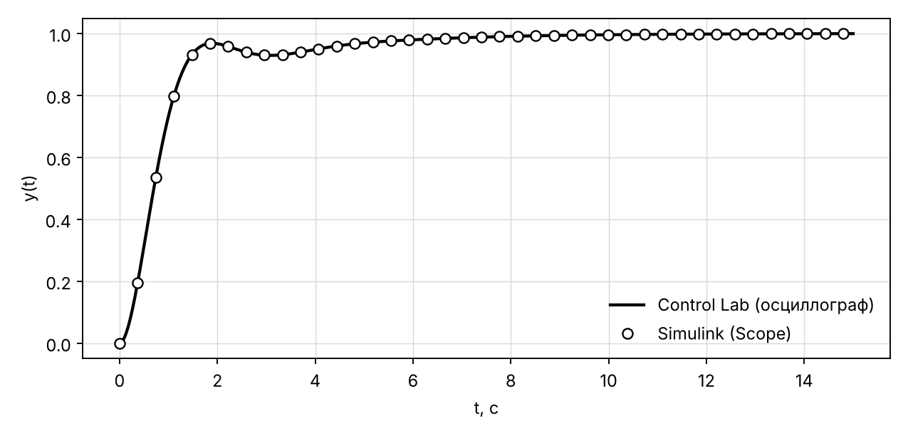
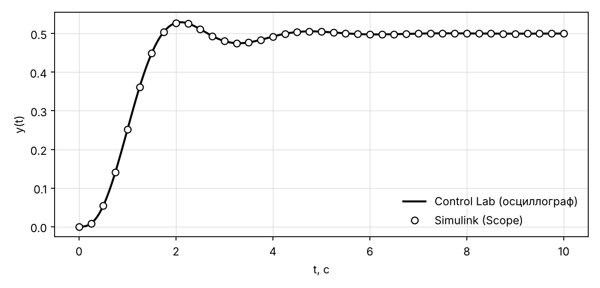
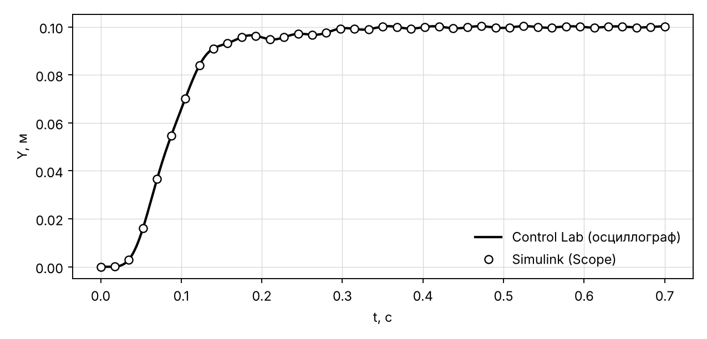

# Верификация подсистемы построения модели

_Сгенерировано `backend/scripts/kp_verification.py` · Python 3.13.16 · Octave запущен._

| схема | порядок n | блоков | знаменатель: макс. отн. расхождение | числитель: макс. отн. расхождение | полюса: макс. отн. расхождение | y(t) против Simulink | y(t) против Xcos | y(t) против Octave lsim |
|---|---|---|---|---|---|---|---|---|
| Контур с ПИ-регулятором | 3 | 6 | 7.8e-16 | 7.8e-16 | 2.2e-16 | 5.8e-09 | 8.9e-09 | 5.8e-09 |
| Перекрёстные обратные связи | 3 | 9 | 8.9e-16 | 2.2e-15 | 1.3e-15 | 2.3e-09 | 2.4e-09 | 2.3e-09 |
| ЭГСП 8-го порядка | 8 | 31 | 2.9e-14 | 1.0e-14 | 4.7e-14 | 7.0e-09 | 6.6e-09 | 7.0e-09 |

### Контур с ПИ-регулятором

Знаменатель (программа): `1 3 6 2`  
Знаменатель (MATLAB/Octave): `1 3 6 2`  
Числитель (программа / MATLAB/Octave): `4 2` / `4 2`

### Перекрёстные обратные связи

Знаменатель (программа): `1 3 8 8`  
Знаменатель (MATLAB/Octave): `1 3 8 8`  
Числитель (программа / MATLAB/Octave): `4` / `4`

### ЭГСП 8-го порядка

Знаменатель (программа): `1 488.657 416828 9.38887e+07 9.37358e+09 1.20487e+12 5.06275e+13 1.60811e+15 1.73036e+16`  
Знаменатель (MATLAB/Octave): `1 488.657 416828 9.38887e+07 9.37358e+09 1.20487e+12 5.06275e+13 1.60811e+15 1.73036e+16`  
Числитель (программа / MATLAB/Octave): `1.73036e+17` / `1.73036e+17`

